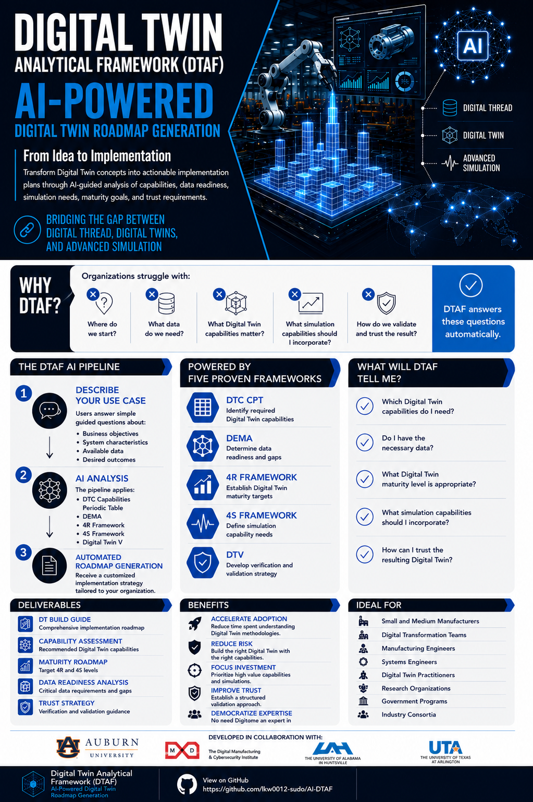

# DTAF AI Pipeline

The **DTAF AI Pipeline** is a guided decision-support tool designed to help manufacturers plan digital twin implementation in a structured and practical way. The pipeline uses the Digital Twin Analytical Framework (DTAF) to move users from an initial digital twin idea to a clearer implementation path by identifying required capabilities, assessing data feasibility, recommending an appropriate digital twin maturity level, determining simulation needs, and outlining verification and validation guidance.

To help users understand how the pipeline works, we created several guideline documents that explain what DTAF is, how its supporting frameworks work together, how to install and run the AI pipeline, what inputs the user needs to provide, and how to interpret the final outputs generated by the program.

## Instructions

The complete set of DTAF AI Pipeline guideline documents is available here:

**[View the DTAF AI Pipeline Instructions](docs/guidelines/README.md)**

## Video Introduction

Watch the DTAF AI Pipeline introduction and supporting walkthrough videos to learn how the framework, guideline documents, and software work together.

**[Watch the DTAF AI Pipeline Video Series on YouTube](https://youtube.com/playlist?list=PLP9TxvomTqJM)**

The introduction video provides an overview of the DTAF AI Pipeline. Additional videos in the playlist provide more focused guidance and demonstrations related to the individual instruction documents.

## Guideline Documents

**[Document 0: Executive Summary](docs/guidelines/00-executive-summary.pdf)**  
   Provides a concise overview of the DTAF AI Pipeline, its purpose, and its intended use.

**[Document 1: Introduction to the DTAF AI Pipeline](docs/guidelines/01-introduction-to-dtaf-ai-pipeline.pdf)**  
   Introduces DTAF and explains how the pipeline's supporting frameworks work together.

**[Document 2: Quick-Start Installation Guide](docs/guidelines/02-quick-start-installation-guide.pdf)**  
   Describes the hardware and software requirements and explains how to install and run the pipeline.

**[Document 3: CNC Case Study](docs/guidelines/03-cnc-case-study.pdf)**  
   Demonstrates how the DTAF AI Pipeline can be applied to a manufacturing use case.

**[Document 4: DEMA CNC Case Study](docs/guidelines/04-dema-cnc-case-study.pdf)**  
   Demonstrates how DEMA can be applied to a manufacturing use case.
   
**[Document 5: DTAF AI Pipeline Quick Demo](docs/guidelines/05-quick-demo.pdf)**  
   Provides a concise demonstration of the pipeline workflow and generated results.

**[Document 6: Supporting Materials](docs/guidelines/06-supporting-materials.pdf)**  
   Contains supplementary information and supporting resources for the DTAF AI Pipeline.

## Recommended Starting Point

New users should begin with **Document 0** and **Document 1** to understand the purpose and structure of the DTAF AI Pipeline.

Users who are ready to install and run the program should proceed to **Document 2**.

Users interested in a complete manufacturing example should review **Document 3**.

## Citation

If you use the DTAF AI Pipeline in your research, publications, or projects, please consider citing the following publication, which introduces the Digital Twin Analytical Framework (DTAF) underlying this software.

**Reference:**

Womack, L., Wooley, A., Ledford, A., & Bitencourt, J. (2026). DTAF: A path toward an integrated approach for digital twin adoption. *Manufacturing Letters, 49*, 1249–1262. https://doi.org/10.1016/j.mfglet.2026.08.032

**DOI:** [10.1016/j.mfglet.2026.08.032](https://doi.org/10.1016/j.mfglet.2026.08.032)

## Funding Acknowledgment

This material is based on research sponsored by Office of the Under Secretary of Defense for Research and Engineering, Strategic Technology Protection and Exploitation, Defense Manufacturing Science and Technology Program under agreement number W911NF-24-3-0006. The U.S. Government is authorized to reproduce and distribute reprints for Governmental purposes notwithstanding any copyright notation thereon.

## Disclaimer

The views and conclusions contained herein are those of the authors and should not be interpreted as necessarily representing the official policies or endorsements, either expressed or implied, of the U.S. Government.
